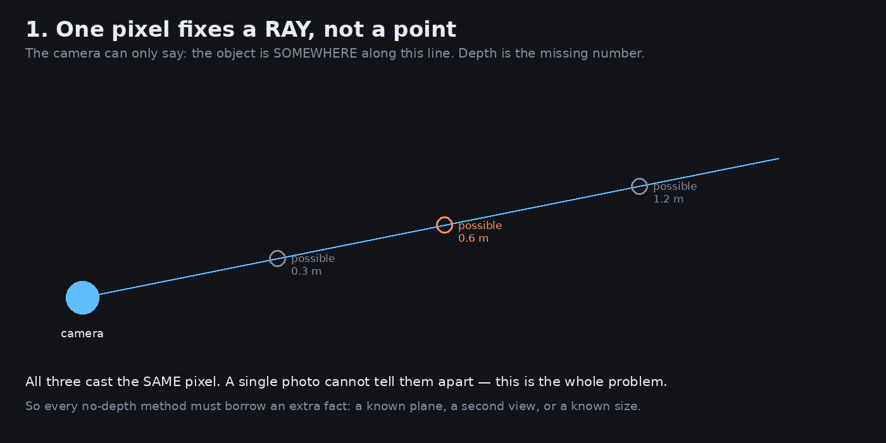
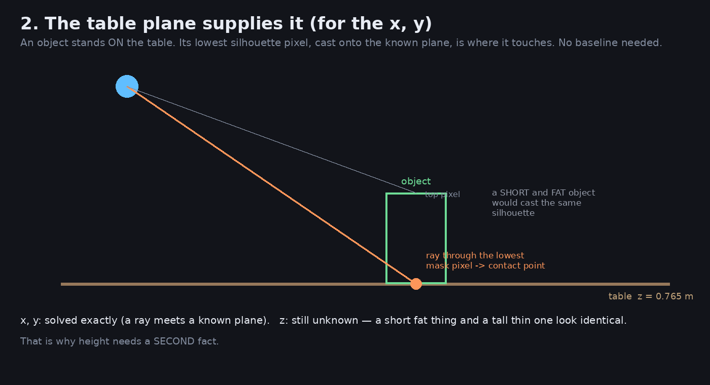
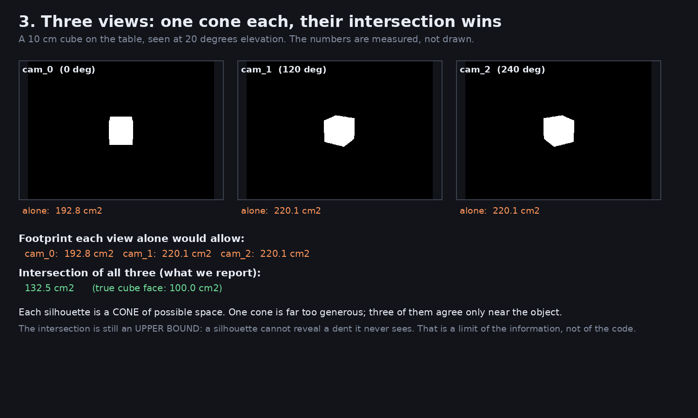
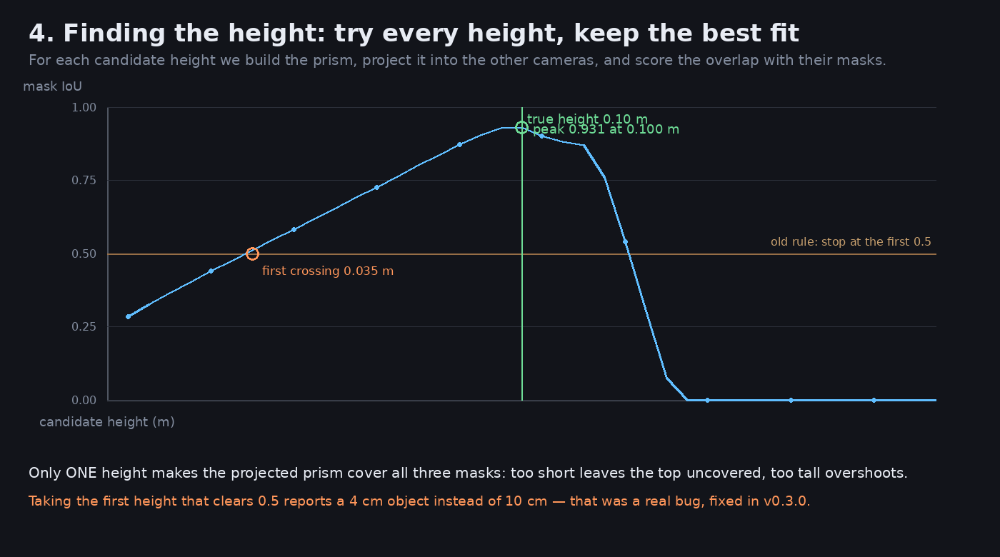

# 无深度时如何定位：图解

> **2026-11-12 文档修订**：旧文基线为 Git 提交 `534066a`；修改原因与已知代码问题见
> [文档修订记录](documentation-changes.md)。本次只改说明，没有重跑实验或重新生成图。
> 原说明在提交 `267ad92`（提交日期 2026-11-10）中加入；该日期不代表另行核实过图像生成或测量时间。
> 下列图表与数字保留自原合成立方体示例，是历史记录，不是当前模型或真实场景的精度承诺。
> 图中的旧措辞也保留供追溯；当前算法与限制以本次更正及 [D35](decisions.md#d35--the-prism-footprint-is-a-column-test-and-the-uncertainty-is-split-in-three) 为准。

> 这个目录里的四张图由 `scripts/explain_localisation.py` 生成，**图中的数字是算出来的**——
> mask 来自和测试同一套解析立方体，不是手画的示意。
>
> 重新生成：`uv run python scripts/explain_localisation.py`

---

## 图 1：一个像素是一条射线，不是一个点



相机看到某个像素时，它能说的只有：

> 「物体在这条线上的**某个位置**」

照片里，0.3 米、0.6 米、1.2 米处的三个物体**投影到同一个像素**，完全无法区分。

**深度是一个缺失的数。** 这就是问题的全部。

所以任何无深度的方法，都必须**借一个额外事实**来确定距离：

| 额外事实 | 从哪来 | 原文的精度描述（历史示例，非保证） |
|---|---|---|
| 已知平面 | 桌面高度 0.765 m | 毫米级（横向） |
| 第二个视角 | 另一台相机 | 取决于基线 |
| 已知尺寸 | 物体库 | 厘米级 |
| 猜测 | 无 | 很差 |

**2026-11-12 更正**：上表保留旧文“毫米级（横向）”“厘米级”等描述。这些量级依赖准确标定、
平面和接触点假设、图像分辨率与分割边缘；额外事实本身不提供固定精度，也没有在此完成真实场景通用精度测量。

---

## 图 2：桌面提供了「平面」这个额外事实



物体**立在桌面上**。那么：

- mask 的**最低像素** → 那条射线打到桌面 → 就是**接触点**
- 数学上是从相机原点出发的射线与 `z = 0.765` 平面求交

**这一步不需要任何基线，也不需要第二个相机。** 一个相机就够，精度是毫米级（取决于 mask 边缘）。

**2026-11-12 更正（保留上句原文）**：射线与已知平面求交确实只需一个相机，但 mask 最低像素
只有在接触处可见、相机朝向适当且物体确实接触该平面时，才可作为接触点近似。
“精度是毫米级”不是算法保证；平面、标定和分割误差都会影响结果。

但**高度仍然未知**。图右侧说明了原因：

> 一个「矮而胖」的物体和一个「高而瘦」的物体，可以投出**完全相同**的轮廓。

所以 z 必须靠**第二个事实**——第二个视角。

---

## 图 3：三个视角，各给一个锥，交集才是答案



图中是解析生成的三个 mask（10cm 合成立方体，20° 仰角），不是模型从真实照片分割的结果。

关键数字（原脚本对该合成场景的历史计算输出，本次未重跑）：

```
cam_0 单独允许的脚印：192.8 cm²
cam_1 单独允许的脚印：220.1 cm²
cam_2 单独允许的脚印：220.1 cm²
三者交集（该历史示例报告的）：132.5 cm²
真实立方体底面：        100.0 cm²
```

**为什么单个视角这么宽松？**

因为一个 mask 对应的不是一个「区域」，而是从相机出发、穿过整个轮廓的**一个锥体**。锥体在地面上切出的面积远大于物体本身。

**三个锥体只在物体附近才彼此同意。**

从 220 cm² 收到 132 cm²——收紧了 40%，但**仍然大于真值 100 cm²**。

### 为什么收不到 100

原文：“因为这是**视觉外壳（visual hull）**，它在数学上永远是真实物体的**上界**”：

- 凸体（方块、球、罐子）→ 加足够视角可以精确
- **凹体（碗、杯子、L 形零件）→ 无论多少视角都会膨胀**

**2026-11-12 更正**：理想、准确轮廓构成的连续视觉外壳包含真实物体；当前实现采用有限视角、
栅格与柱体内部采样，另有分割／标定误差，不能把理想上界当作数值结果的严格保证。
上面关于所有凹体的说法过强：部分外部凹形可以由轮廓约束，不能把 L 形等一概断言为必然膨胀。
从所有观测轮廓都不可见的内部／凹陷结构无法仅靠这些轮廓恢复，完整物体补全也不是该实现的输出。

---

## 图 4：找高度——试遍每个高度，取拟合最好的



有了横向位置，还剩高度。做法是：

```
对每个候选高度 h：
    1. 在桌面上取「柱体内部的采样点都投在所有 mask 内」的格子 → 候选脚印
    2. 把这个棱柱投影回全部参与视角
    3. 和各视角的 mask 算 IoU（重叠度），取平均
取完整候选高度曲线上平均 IoU 最高的 h
```

原文：“**只有一个高度能让投影的棱柱同时覆盖三个 mask**”：

- 太矮 → 投影出来够不到 mask 的顶部
- 太高 → 投影出来超出 mask

**2026-11-12 更正**：这是原图特定立方体曲线的直观说明，不保证其它物体也只有一个峰值。
实际 `_height_curve_grid` 对全部参与视角计算平均 IoU，而不是只算“其他相机”；
柱体检查在高度的 0.15、0.5、0.85 处采样，不能视作每个连续点都满足约束的严格证明。
多峰、离散步长、遮挡和模型假设均会影响所选高度。图内的 “other cameras”／“Only ONE height”
保留为历史措辞，本次没有重绘。

### 图里两个标记的意义

```
绿点（峰值）：0.100 m   ← 该历史示例的答案，真值也是 0.100 ✅
橙圈（首个达标）：0.035 m ← 旧规则的答案，差了 3 倍 ❌
```

**这是 v0.3.0 修掉的一个真实 bug。**

原来的实现按 spec 的措辞「取**最小**的、IoU 达标的那个高度」，而曲线在 h=0.035 时就已越过 0.5 阈值（虽然峰值在 0.100）。

后果不只是高度错：`top_z` 和质心的 z 都低了**半个物体高度**。

---

## 完整流程回顾

```
输入：3 张 RGB 图 + 相机内外参 + 桌面高度
  ↓
① SAM3 分割 → 每个相机得到 mask
  ↓
② 假设物体立在桌面
  ↓
③ 试遍高度 h，构造「柱体采样点都投在所有 mask 内」的候选棱柱
  ↓
④ 投影回全部参与视角，取平均 IoU 峰值 → 估计 h
  ↓
⑤ 输出：可见轮廓／柱体假设下的中心、顶部、包围盒、朝向与不确定度估计
```

**注意第 ④ 步是关键的分歧点**：

| 做法 | 结果 |
|---|---|
| 只有 1 个相机、无深度 | 已知桌面与假定物高下给粗略 3D；当前高度不确定度下限 0.05 m，无桌面信息不给几何 |
| ≥ 2 个相机、无深度 | 在轮廓／桌面／柱体假设下估计高度；IoU 可能多解，不保证完整物体尺寸 |

旧文：“这解释了为什么 PyRUA-Lean 的 `views` 字段是核心指标（`views==1` 时明确标注「高度是猜的」）。”

**2026-11-12 更正**：本项目字段是 `percepta.Geometry.views_used`，记录实际贡献视角数。
应同时查看 `method`、分轴 uncertainty 和 `extras` 中的警告；`views_used==1` 本身不等于高度靠猜，
因为单视角也可能带实测深度。本文讨论的是无深度轮廓路径。

---

## 为什么这决定了精度上限

| 项 | 旧文“能做到”的描述（历史保留） | 靠什么 |
|---|---|---|
| 横向位置 (x, y) | **毫米级** | 平面约束，不需基线 |
| 高度 z | **1–3 mm**（两视角以上） | IoU 匹配 |
| 高度 z | **厘米级，且是猜的**（单视角） | 无 |
| 完整表面 / 凹形 | **不可能** | 轮廓信息上限 |

**2026-11-12 更正**：保留“毫米级”“1–3 mm”“厘米级”等原文数值以供追溯，不能把它们当作
当前实现、SAM3 或各神经深度模型的通用测量保证。仅有 IoU 峰值和视角数不能给出固定精度；
后面的历史合成实验也出现厘米级误差。“完整表面／凹形不可能”仅适用于轮廓中始终不可观测的结构，
不是说所有外部凹形都无法恢复。

原文：“**最后一行无法通过增加相机、改进算法突破。** 想突破只有三条路：”

1. 开深度相机（硬件）
2. 学习先验（用数据补凹形，需训练）
3. 时序融合（机械臂移动中积累多视角，需跨帧跟踪）

这些是获取额外观测或先验的例子，不是穷尽列表；时序轮廓本身也不能揭示一直不可见的内部结构。

---

## 和 percepta 代码的对应

| 图的步骤 | 代码位置 |
|---|---|
| 图 1、2 的射线与平面求交 | `geometry.ray_horizontal_plane` |
| 图 3 的列检查 | `hull.column_inside` |
| 图 3 的脚印度量 | `hull.footprint_metrics` |
| 图 4 的高度曲线 | `fusion._height_curve_grid` |
| 图 4 的峰值选择 | `fusion._fuse_prism` |
| 三者的调度 | `fusion.fuse` |

---

## 历史合成场景误差记录（`scripts/footprint_accuracy.py`）

以下数字原样保留自旧文；本次没有重新执行该脚本，也不据此比较当前模型或给出精度承诺。

| 相机布局 | 质心误差 | 高度误差 |
|---|---|---|
| 0°/120°/240° | 0.33–1.04 cm | 0–2 cm |
| 0°/180°（旧文标签“正对，最差”） | 0.50–1.00 cm | 1–2 cm |
| 0°/90°/180°/270°（四视角） | 0.01–1.50 cm | 0–3 cm |

旧文原句（已撤回）：

> **注意 0°/180° 是最差的配置**：两个相机看的是物体的同一面，轮廓高度冗余，几何上等价于一个相机。

**2026-11-12 更正（保留上句作为历史错误）**：相反方位的相机通常观察物体的相对两侧，
不能说它们看同一面或几何上等价于一个相机。“最差”也不是一般定理；约束强弱取决于物体形状、
视线夹角、遮挡、基线和具体估计方法。上表只记录原合成实验，不支持这种普遍结论。
视角数量也不是独立的置信度指标，应结合实际可见性和几何约束解释。

## 当前已知代码限制

本次文档核对确认了轮廓路径中两项尚未修复的问题：`_hang_cells()` 的世界 XY／网格像素坐标
混用会导致 hang 候选为空或错位；`_lateral_uncertainty()` 的距离计算会让估计随世界原点改变。
详见[文档修订记录](documentation-changes.md)中的 `DOC-20261112-01`、`DOC-20261112-02`。
本文没有修复它们，因此不能据历史图表声称 hang 路径可靠或 uncertainty 是严格误差界。
